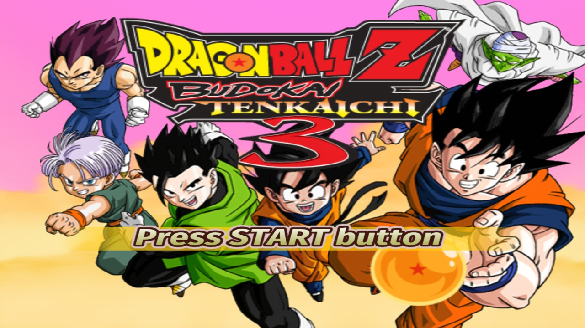
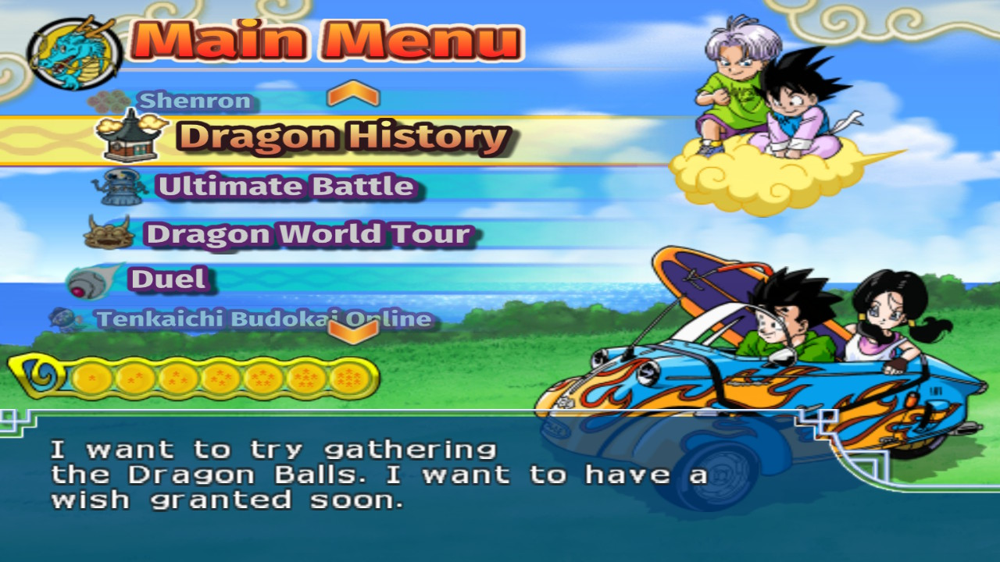
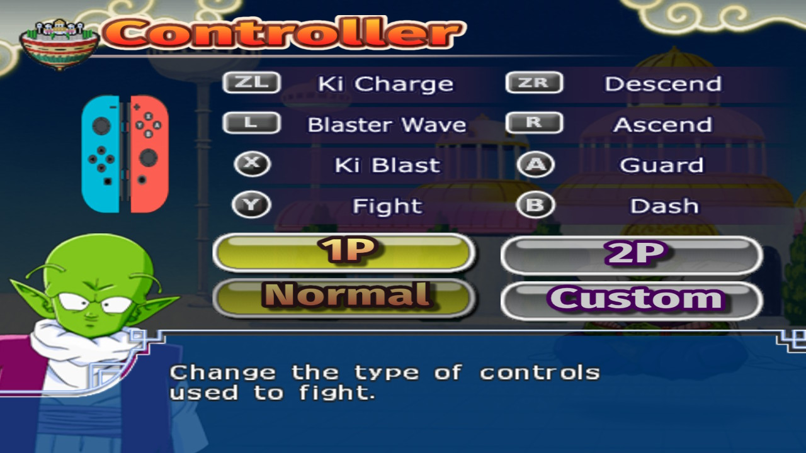

<h1 align="center">Tenkaichi3Decomp for the Nintendo Switch</h1>

  
  
  

   
  
  

A native Nintendo Switch port of **Dragon Ball Z: Budokai Tenkaichi 3** (PS2, USA release), based on z3xox's
[Tenkaichi3Decomp](https://github.com/z3xox/Tenkaichi3Decomp), the PC port built on the BT3-Decompiled
decompilation. The game's own code runs natively on the console: it is not an emulator.

This repository contains **no game data**: you need your own disc. This is an unofficial port, not affiliated with
the Tenkaichi3Decomp project: please report Switch problems here, not upstream.

## Features

- **The whole game**: Dragon History, Ultimate Battle, Dragon World Tour, Duel, saving, films, docked and handheld.
- **30 fps fights** with the PS2's effects (outlines, glow, blur), up to 3x resolution, 4:3 to 16:9.
- **Switch buttons everywhere**: A/B/X/Y and L/R/ZL/ZR icons, Joy-Cons on the Controller page, A to choose and
  B to go back in the menus.
- **Local 1P vs 2P**: a Joy-Con each, held sideways, or two controllers, picked on the console's own screen.
- **Automatic updates**: the game tells you about a new release and installs it itself.
- **Mods, texture packs, extra songs and stages**, and saves you can move between PC and Switch.
- **Settings window**: press **+ and −** together (the PC version's F1).

In fights the buttons match the PS2 pad by position (B = ✕, A = ○, Y = □, X = △, ZL/ZR = L2/R2). A sideways
Joy-Con uses SL as ZL, SR as R, and its top buttons as L and ZR; its stick also moves through the menus.

**Known issues**: two-player split screen runs at about 20 fps; online play is not available yet.

## Installation

You need:

- a Switch with **Atmosphère** and the homebrew menu;
- **sys-clk**, included in the [HATS pack](https://sthetix.info/hats/releases/): the game sets the clocks it needs by
  itself (without it, fights run at 16–20 fps);
- your **disc image** of the USA release (`.iso`), or the **PC version** of
  [Tenkaichi3Decomp](https://github.com/z3xox/Tenkaichi3Decomp) already installed from it.

Steps:

1. Download **`Tenkaichi3Decomp-switch-setup.exe`** from the
   [latest release](https://github.com/excinus/Tenkaichi3Decomp-NX/releases/latest) and start it (anywhere on your PC).
2. Choose your disc image or your PC version's folder, then your SD card, and press **Install**. It puts the game and
   its data on the card (a few minutes).
3. On the Switch, open the homebrew menu **through a game** (hold R while starting any game) and start
   **Tenkaichi3Decomp**.
4. *Optional, recommended:* put the game on the HOME menu with a forwarder made by
   [sphaira](https://github.com/NaGaa95/sphaira), so it starts like any other game.

Without Windows: `Tenkaichi3Decomp-switch.zip` and `INSTALL.txt` in it.

## Troubleshooting

- **Slow fights**: sys-clk is missing or not running.
- **"Not enough memory"** or the game won't start: open the homebrew menu through a game (hold R), not the album.
- **A crash or freeze**: send `bt3_log.txt` and `bt3_crash.txt` from `atmosphere/contents/0100B73DEC000000/` with
  your report.

## Building

See [docs/port/switch_plan.md](docs/port/switch_plan.md). In devkitPro's container with LLVM 22:
`sh port/switch/release/build.sh .` builds both zips, then `sh port/switch/setup/build.sh win` the Windows setup
(with mingw-w64); no game files are needed. The rest of the repository is
Tenkaichi3Decomp, followed release by release; for the PC version, use
[upstream](https://github.com/z3xox/Tenkaichi3Decomp).

## Credits

- [z3xox](https://github.com/z3xox) and the contributors of [Tenkaichi3Decomp](https://github.com/z3xox/Tenkaichi3Decomp),
  and the authors of the BT3-Decompiled decompilation
- [arielxflores](https://github.com/arielxflores)'s [PS Vita port](https://github.com/arielxflores/Tenkaichi3Decomp-Vita)
- Spike, the developer of Budokai Tenkaichi 3
- [switchbrew](https://github.com/switchbrew) (libnx), [devkitPro](https://devkitpro.org/),
  [Atmosphère](https://github.com/Atmosphere-NX/Atmosphere), [sys-clk](https://github.com/retronx-team/sys-clk),
  SDL and Mesa

## License

The port's code is under the [GNU AGPL v3](LICENSE) (code from before October 2026 also under [MIT](LICENSE-MIT)).
The game's code in `src/` and `include/` comes from the decompilation and belongs to the game's rights holders. This
project is not affiliated with or endorsed by them or by Nintendo, and distributes none of the game's data: you need
your own legally obtained copy of the game.
